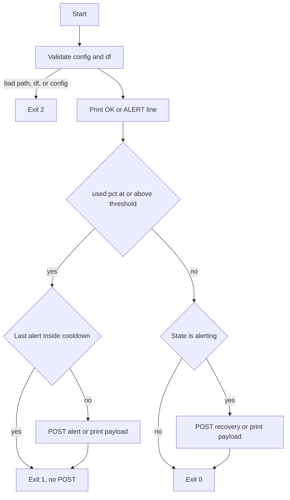

# Disk usage monitor

Checks one filesystem on a schedule and posts to Slack when usage crosses a threshold.

## Problem

A full disk takes a machine down after the fact. Checking the used percentage on a timer, and notifying only when it stays over a threshold, leaves time to free space before the volume fills.

## Solution

`disk_monitor.sh` reads usage with `df -Pk`, prints one timestamped `OK` or `ALERT` line, and posts to a Slack incoming webhook when the used percentage is at or above `DISK_THRESHOLD`. Repeat alerts wait until `COOLDOWN_MIN` has passed. When usage falls back under the threshold, the script sends one recovery message.

Email alerts are **planned**. This version notifies Slack only.

Related: [Markplowwright/endpoint-health-audit](https://github.com/Markplowwright/endpoint-health-audit).

## Tech stack

- bash 3.2, so the script runs on macOS `/bin/bash` and on Linux
- `df -Pk` for POSIX disk usage in 1024-byte blocks
- `curl` for the Slack webhook
- launchd on macOS (`StartInterval` 900)
- cron on Linux (every 15 minutes)
- an Ubuntu Docker image that copies the script

## How to run

A value already in the environment wins. If a variable is unset, the script reads `KEY=VALUE` lines from `${DISK_MONITOR_ENV:-<directory of this script>/.env}` when that file exists. Blank lines and lines whose first non-whitespace character is `#` are skipped. A value wrapped in one matching pair of single or double quotes has that pair removed. The file is not sourced. Anything still unset gets a default.

- `DISK_PATH` — filesystem to check. Default is `/System/Volumes/Data` on macOS and `/` on Linux.
- `DISK_THRESHOLD` — integer from 1 to 100. Default `85`. Alert when used percent is at or above this value.
- `COOLDOWN_MIN` — minutes before another alert. Default `240`.
- `SLACK_WEBHOOK_URL` — Slack incoming webhook. Used only when a message is sent.

Copy `.env.example` to `.env` and run `chmod 600 .env`. `.env` and `config/monitor.conf` are gitignored. Do not commit a webhook URL.

Alert state is one file per `DISK_PATH`, named `state_` plus that path with every character outside `A-Za-z0-9` replaced by `_`, under `${XDG_STATE_HOME:-$HOME/.local/state}/disk-usage-monitor`.

If a real send is needed and `SLACK_WEBHOOK_URL` is empty, the script prints `warning: SLACK_WEBHOOK_URL not set, notification not sent` on stderr, does not write state, and continues.

Dry run (prints the JSON that would be sent, sends nothing, does not write state):

```bash
DISK_THRESHOLD=1 ./disk_monitor.sh --dry-run
```

Exit codes: `0` below the threshold, `1` at or above the threshold, `2` for a bad path, a `df` failure, or bad configuration. A failed Slack POST, or a missing webhook on a real send, does not change the exit code.

### macOS (launchd)

Copy the example plist into LaunchAgents:

```bash
cp launchd/com.markplowwright.diskmonitor.plist.example \
  "$HOME/Library/LaunchAgents/com.markplowwright.diskmonitor.plist"
```

Edit that copy. Replace every `/ABSOLUTE/PATH/TO/...` placeholder with a path on this machine, and replace `REPLACE_WITH_SLACK_WEBHOOK_URL` with the webhook. Create the log directory you set in `StandardOutPath` and `StandardErrorPath`.

```bash
launchctl bootstrap "gui/$(id -u)" \
  "$HOME/Library/LaunchAgents/com.markplowwright.diskmonitor.plist"
```

The job runs every 900 seconds. Stop it with:

```bash
launchctl bootout "gui/$(id -u)" \
  "$HOME/Library/LaunchAgents/com.markplowwright.diskmonitor.plist"
```

### Linux (cron)

Edit `cron/crontab.example`. Replace `/ABSOLUTE/PATH/TO/disk_monitor.sh` and `REPLACE_WITH_SLACK_WEBHOOK_URL`, then install the line with `crontab -e`. The example runs every 15 minutes and sets `DISK_PATH` to `/`.

### Docker

Build from the repository root so `COPY` can see the script:

```bash
docker build -f docker/Dockerfile -t disk-usage-monitor .
docker run --rm \
  -e DISK_PATH=/ \
  -e DISK_THRESHOLD=85 \
  -e SLACK_WEBHOOK_URL='REPLACE_WITH_SLACK_WEBHOOK_URL' \
  disk-usage-monitor --dry-run
```

`df` inside the container sees the container filesystem. Mount a host volume and set `DISK_PATH` when you need to measure a host path.

## Flow



## Results

_Placeholder. Fill in after the first scheduled runs._

## Tested on

_Placeholder._
